  <a href="https://codewithgabriel.com">
    <picture>
      <source media="(prefers-color-scheme: dark)" srcset="https://raw.githubusercontent.com/gabrimoreira/gabrimoreira/main/assets/header-dark.svg">
      <source media="(prefers-color-scheme: light)" srcset="https://raw.githubusercontent.com/gabrimoreira/gabrimoreira/main/assets/header-light.svg">
      
    </picture>
  </a>

  
  
  

## My contributions as a Game of Life

<picture>
  <source media="(prefers-color-scheme: dark)" srcset="https://raw.githubusercontent.com/gabrimoreira/gabrimoreira/output/life-dark.svg">
  <source media="(prefers-color-scheme: light)" srcset="https://raw.githubusercontent.com/gabrimoreira/gabrimoreira/output/life-light.svg">
  
</picture>

My real contribution graph is the starting point of [Conway's Game of Life](https://en.wikipedia.org/wiki/Conway%27s_Game_of_Life). Updated daily.

## About

Full-stack TypeScript developer and Computer Engineering student at UFC, Brazil. I build internal tools at Raposo Plástico, and browser games and simulators on my own time.

## Experience

- **Software Development Intern, Raposo Plástico** · 2026 to present\
  FlowPilot, an internal platform for tasks and routines. Vue 3, NestJS, PostgreSQL.
- **Undergraduate Research Fellow, UFC** · Sep 2024 to Nov 2025\
  Quantum circuit simulation. Python, NumPy.
- **Full Stack Developer and Project Manager, GTI Junior Enterprise** · 2024\
  React and Node.js apps, Scrum lead.

## Projects

| Project | What it is | Try it |
| --- | --- | --- |
| [**Capital**](https://github.com/gabrimoreira/business_simulator) | Life and business simulator, from age 18 to 65. `Vue 3` `PWA` | [Play](https://businesssimulator.vercel.app) |
| [**Casa Sandbox**](https://github.com/gabrimoreira/threejs_house) | 3D home decoration game. `three.js` | [Play](https://threejshouse-two.vercel.app) |
| [**Vida**](https://github.com/gabrimoreira/life-simulator) | Life simulator that works offline, one turn per year. `Vue` `PWA` | [Play](https://life-simulator-133.pages.dev) |
| [**Document OCR AI**](https://github.com/gabrimoreira/document-ocr-ai) | Extracts amounts and dates from invoices with Gemini. `Next.js` `NestJS` | [Demo](https://document-ocr-ai.vercel.app) |
| [**Helpdesk**](https://github.com/gabrimoreira/helpdesk) | Multi-tenant ticketing system. `Vue 3` `NestJS` `PostgreSQL` | |
| [**EventFlow**](https://github.com/gabrimoreira/events-backend) *(in progress)* | Ticketing backend, with microservices for AWS. `Node.js` `Docker` | |
| [**Brazil in data**](https://github.com/kelvinleandro/censo-dataviz-react) *(team)* | Scrollytelling on the 2022 Census. `Next.js` `D3.js` | [Demo](https://censo-2022-dataviz.vercel.app/) |
| [**Lung segmentation**](https://github.com/gabrimoreira/lung-segmentation-web) *(team)* | Segment and edit CT scans in the browser. `React` `DICOM` | [Demo](https://lung-segmentation-web.vercel.app) |

More: [D3.js notebooks](https://observablehq.com/collection/@gabriel-moreira-de-andrade/interactive-visualizations)

## Research

[Proposal of a photonic quantum full adder](https://codewithgabriel.com/docs/artigo-qfa.pdf) (PDF, in Portuguese), co-author. WECIQ 2025.

Coursework: [Computational Intelligence](https://github.com/gabrimoreira/university-docs/tree/main/ica) · [Software Verification & Validation](https://github.com/gabrimoreira/university-docs/tree/main/v%26v)

## Stack

| Area | Tools |
| --- | --- |
| **Front end** |  |
| **Back end** |  |
| **Infra** |  Railway, DigitalOcean |
| **Data** |  |
| **Testing** |  |
| **University** |  |

## GitHub activity

  <picture>
    <source media="(prefers-color-scheme: dark)" srcset="https://raw.githubusercontent.com/gabrimoreira/gabrimoreira/output/stats-dark.svg">
    <source media="(prefers-color-scheme: light)" srcset="https://raw.githubusercontent.com/gabrimoreira/gabrimoreira/output/stats-light.svg">
    
  </picture>
  <picture>
    <source media="(prefers-color-scheme: dark)" srcset="https://raw.githubusercontent.com/gabrimoreira/gabrimoreira/output/langs-dark.svg">
    <source media="(prefers-color-scheme: light)" srcset="https://raw.githubusercontent.com/gabrimoreira/gabrimoreira/output/langs-light.svg">
    
  </picture>

  <picture>
    <source media="(prefers-color-scheme: dark)" srcset="https://raw.githubusercontent.com/gabrimoreira/gabrimoreira/output/streak-dark.svg">
    <source media="(prefers-color-scheme: light)" srcset="https://raw.githubusercontent.com/gabrimoreira/gabrimoreira/output/streak-light.svg">
    
  </picture>
  <picture>
    <source media="(prefers-color-scheme: dark)" srcset="https://raw.githubusercontent.com/gabrimoreira/gabrimoreira/output/contributions-dark.svg">
    <source media="(prefers-color-scheme: light)" srcset="https://raw.githubusercontent.com/gabrimoreira/gabrimoreira/output/contributions-light.svg">
    
  </picture>

## Latest commits

<!-- recent-commits:start -->
| Repository | Commit | Date |
| --- | --- | --- |
| [`threejs_house`](https://github.com/gabrimoreira/threejs_house) | [Fase 6: polimento](https://github.com/gabrimoreira/threejs_house/commit/090e95007206ef03539b0ca18cbc5b8d537c0054) | Oct&nbsp;30,&nbsp;2026 |
| [`portfolio`](https://github.com/gabrimoreira/portfolio) | [feat: redesign portfolio with terminal hero, experience section and PT/…](https://github.com/gabrimoreira/portfolio/commit/6abb34711102a8c04842337fb48d3919878ead5c) | Oct&nbsp;16,&nbsp;2026 |
| [`events-backend`](https://github.com/gabrimoreira/events-backend) | [docs: remove roadmap from README](https://github.com/gabrimoreira/events-backend/commit/f72db120ce65b1e8d8bac9f1bdea6d6213212642) | Sep&nbsp;27,&nbsp;2026 |
| [`fitness_app`](https://github.com/gabrimoreira/fitness_app) | [Fase 1: núcleo estatístico com testes e seed sintético](https://github.com/gabrimoreira/fitness_app/commit/54819f9c8bba1ca9a718354370f7d27dac5d469d) | Sep&nbsp;15,&nbsp;2026 |
| [`business_simulator`](https://github.com/gabrimoreira/business_simulator) | [fix\(runner\): a \`tycoon\` nunca comprava jornal, e era isso que invertia…](https://github.com/gabrimoreira/business_simulator/commit/0fcbd5bdaca60440fa9238e341eda7c0671610e5) | Sep&nbsp;13,&nbsp;2026 |
<!-- recent-commits:end -->

  <picture>
    <source media="(prefers-color-scheme: dark)" srcset="https://raw.githubusercontent.com/gabrimoreira/gabrimoreira/output/snake-dark.svg">
    <source media="(prefers-color-scheme: light)" srcset="https://raw.githubusercontent.com/gabrimoreira/gabrimoreira/output/snake-light.svg">
    
  </picture>

