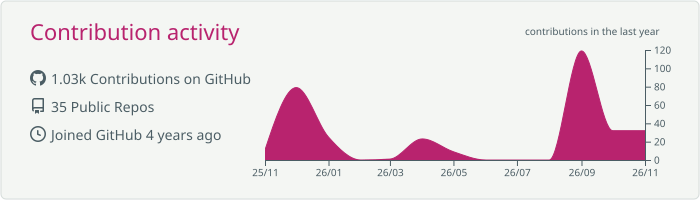

  <a href="https://codewithgabriel.com">
    <picture>
      <source media="(prefers-color-scheme: dark)" srcset="https://raw.githubusercontent.com/gabrimoreira/gabrimoreira/main/assets/header-dark.svg">
      <source media="(prefers-color-scheme: light)" srcset="https://raw.githubusercontent.com/gabrimoreira/gabrimoreira/main/assets/header-light.svg">
      
    </picture>
  </a>

  
  
  

## About

I'm a Computer Engineering undergraduate at the Federal University of Ceará (UFC), Brazil, in my 10th semester, and a software development intern at Raposo Plástico, where I build FlowPilot, the company's internal platform for managing tasks and routines.

Most of my work is full-stack TypeScript: Vue or React on the front end, NestJS or Express on the back end, PostgreSQL for data. Lately my own projects are browser games and simulators that run entirely on the device, with no backend. I also spent over a year in undergraduate research on quantum circuit simulation.

## Experience

**Software Development Intern, Raposo Plástico** · 2026 to present\
Digital transformation of a plastics recycling company. I build FlowPilot end to end with Vue 3, Tailwind CSS, NestJS, TypeORM and PostgreSQL, deploy on Railway with the database on DigitalOcean, and plan the schema migrations.

**Undergraduate Research Fellow, Federal University of Ceará** · Sep 2024 to Nov 2025\
Scripts for quantum circuit simulation and data processing with Python and NumPy, in an academic team working on mathematical and algorithmic problems.

**Full Stack Developer and Project Manager, GTI Junior Enterprise** · Jan to Dec 2024\
Built React and Tailwind interfaces from Figma prototypes and REST APIs with Node.js and Express. As manager, I ran the Scrum ceremonies and kept versioning and delivery on track.

## Featured projects

| Project | What it is |
| --- | --- |
| **Capital** [Play](https://businesssimulator.vercel.app) · [Code](https://github.com/gabrimoreira/business_simulator) | Life and business simulator. Start at 18 with R$ 600 and play until 65: work, study, invest and found companies. A headless runner plays decades in seconds to balance the economy. `Vue 3` `TypeScript` `Pinia` `Tailwind CSS` `IndexedDB` `PWA` |
| **Casa Sandbox** [Play](https://threejshouse-two.vercel.app) · [Code](https://github.com/gabrimoreira/threejs_house) | 3D home decoration game in the browser. The house is generated from JSON; place and swap low-poly furniture, paint walls and walk around in first person. `three.js` `TypeScript` `Vite` |
| **Vida** [Play](https://life-simulator-133.pages.dev) · [Code](https://github.com/gabrimoreira/life-simulator) | Turn-based life simulator where one turn is one year. Installable and works in airplane mode, with a pure, testable engine kept separate from its content. `Vue` `Pinia` `TypeScript` `PWA` |
| **Document OCR AI** [Demo](https://document-ocr-ai.vercel.app) · [Code](https://github.com/gabrimoreira/document-ocr-ai) | Document platform that uses Google Gemini to extract amounts, dates and summaries from invoices and receipts, with per-user data isolation. `Next.js` `NestJS` `Prisma` `Supabase` `Gemini` |
| **Helpdesk** [Code](https://github.com/gabrimoreira/helpdesk) | Multi-tenant ticketing system that routes requests by department, with JWT authentication, role-based access and JSON-driven dynamic forms. `Vue 3` `PrimeVue` `NestJS` `TypeORM` `PostgreSQL` `Docker` |
| **EventFlow** *(in progress)* [Code](https://github.com/gabrimoreira/events-backend) | Backend for an event ticketing platform, for a cloud development course at UFC: Node.js microservices targeting AWS (EC2 with Auto Scaling, RDS, S3, ElastiCache, DynamoDB, SNS/SQS). The services, gateway and queues are set up; the API routes are still being implemented. `Node.js` `TypeScript` `Docker` `AWS` |
| **Brazil in data: 2022 Census** *(team project)* [Demo](https://censo-2022-dataviz.vercel.app/) · [Code](https://github.com/kelvinleandro/censo-dataviz-react) | Scrollytelling piece on Brazil's demographic transition, with interactive choropleth maps and charts. `Next.js` `D3.js` `TypeScript` `PostgreSQL` |
| **Lung segmentation** *(team project)* [Demo](https://lung-segmentation-web.vercel.app) · [Code](https://github.com/gabrimoreira/lung-segmentation-web) | Web interface for CT scans: upload DICOM files, run segmentation algorithms, edit contours by hand and export the results. `React` `TypeScript` `shadcn/ui` `DICOM` |

More: [interactive D3.js and Vega-Lite notebooks](https://observablehq.com/collection/@gabriel-moreira-de-andrade/interactive-visualizations) on Observable.

## Research

**Proposta de um Somador Completo Quântico Fotônico** *(Proposal of a photonic quantum full adder)*, 2025\
Orleans C. V. Cardoso, **Gabriel M. de Andrade** and João Batista R. Silva. 8th Workshop-School on Quantum Computation and Information (WECIQ), UFSC, Florianópolis.\
A quantum full adder in a photonic architecture built on coherent states and linear optics, extending the QPU X platform to reversible arithmetic. [Read the PDF, in Portuguese](https://codewithgabriel.com/docs/artigo-qfa.pdf).

Coursework reports: [Applied Computational Intelligence](https://github.com/gabrimoreira/university-docs/tree/main/ica) · [Software Verification & Validation](https://github.com/gabrimoreira/university-docs/tree/main/v%26v)

## Stack

| Area | Tools |
| --- | --- |
| **Front end** |  |
| **Back end** |  |
| **Infra** |  Railway, DigitalOcean |
| **Data** |  |
| **Testing** |  |
| **University** |  |

## GitHub activity

  <picture>
    <source media="(prefers-color-scheme: dark)" srcset="https://raw.githubusercontent.com/gabrimoreira/gabrimoreira/output/stats-dark.svg">
    <source media="(prefers-color-scheme: light)" srcset="https://raw.githubusercontent.com/gabrimoreira/gabrimoreira/output/stats-light.svg">
    
  </picture>
  <picture>
    <source media="(prefers-color-scheme: dark)" srcset="https://raw.githubusercontent.com/gabrimoreira/gabrimoreira/output/langs-dark.svg">
    <source media="(prefers-color-scheme: light)" srcset="https://raw.githubusercontent.com/gabrimoreira/gabrimoreira/output/langs-light.svg">
    
  </picture>

  <picture>
    <source media="(prefers-color-scheme: dark)" srcset="https://raw.githubusercontent.com/gabrimoreira/gabrimoreira/output/streak-dark.svg">
    <source media="(prefers-color-scheme: light)" srcset="https://raw.githubusercontent.com/gabrimoreira/gabrimoreira/output/streak-light.svg">
    
  </picture>
  <picture>
    <source media="(prefers-color-scheme: dark)" srcset="https://raw.githubusercontent.com/gabrimoreira/gabrimoreira/output/contributions-dark.svg">
    <source media="(prefers-color-scheme: light)" srcset="https://raw.githubusercontent.com/gabrimoreira/gabrimoreira/output/contributions-light.svg">
    
  </picture>

## Latest commits

The most recent commit from each of my most active public repositories, updated automatically.

<!-- recent-commits:start -->
| Repository | Commit | Date |
| --- | --- | --- |
| [`threejs_house`](https://github.com/gabrimoreira/threejs_house) | [Fase 6: polimento](https://github.com/gabrimoreira/threejs_house/commit/090e95007206ef03539b0ca18cbc5b8d537c0054) | Oct&nbsp;30,&nbsp;2026 |
| [`portfolio`](https://github.com/gabrimoreira/portfolio) | [feat: redesign portfolio with terminal hero, experience section and PT/…](https://github.com/gabrimoreira/portfolio/commit/6abb34711102a8c04842337fb48d3919878ead5c) | Oct&nbsp;16,&nbsp;2026 |
| [`events-backend`](https://github.com/gabrimoreira/events-backend) | [docs: remove roadmap from README](https://github.com/gabrimoreira/events-backend/commit/f72db120ce65b1e8d8bac9f1bdea6d6213212642) | Sep&nbsp;27,&nbsp;2026 |
| [`fitness_app`](https://github.com/gabrimoreira/fitness_app) | [Fase 1: núcleo estatístico com testes e seed sintético](https://github.com/gabrimoreira/fitness_app/commit/54819f9c8bba1ca9a718354370f7d27dac5d469d) | Sep&nbsp;15,&nbsp;2026 |
| [`business_simulator`](https://github.com/gabrimoreira/business_simulator) | [fix\(runner\): a \`tycoon\` nunca comprava jornal, e era isso que invertia…](https://github.com/gabrimoreira/business_simulator/commit/0fcbd5bdaca60440fa9238e341eda7c0671610e5) | Sep&nbsp;13,&nbsp;2026 |
<!-- recent-commits:end -->

  <picture>
    <source media="(prefers-color-scheme: dark)" srcset="https://raw.githubusercontent.com/gabrimoreira/gabrimoreira/output/snake-dark.svg">
    <source media="(prefers-color-scheme: light)" srcset="https://raw.githubusercontent.com/gabrimoreira/gabrimoreira/output/snake-light.svg">
    
  </picture>

